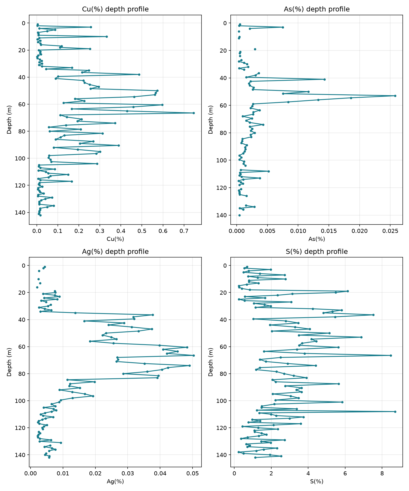
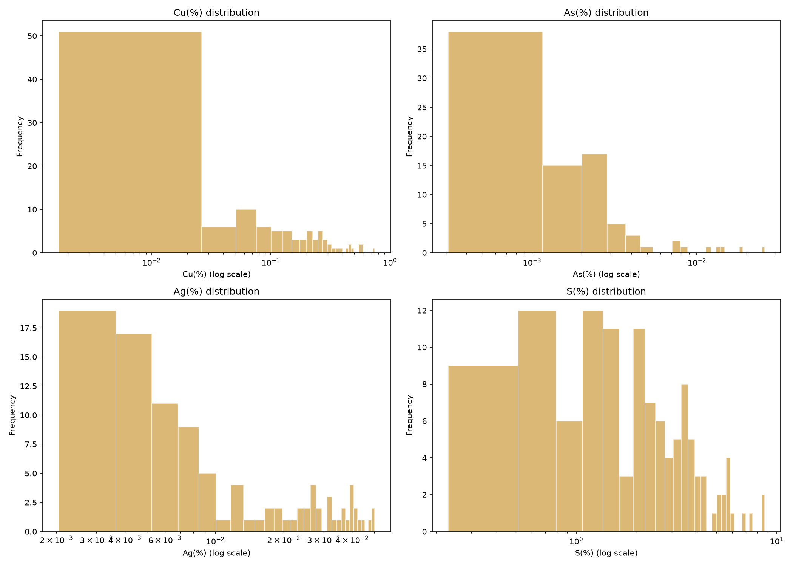
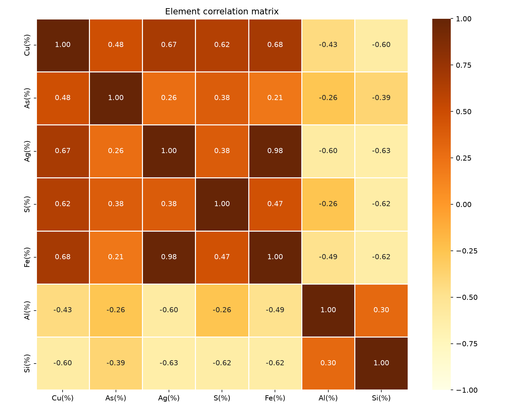
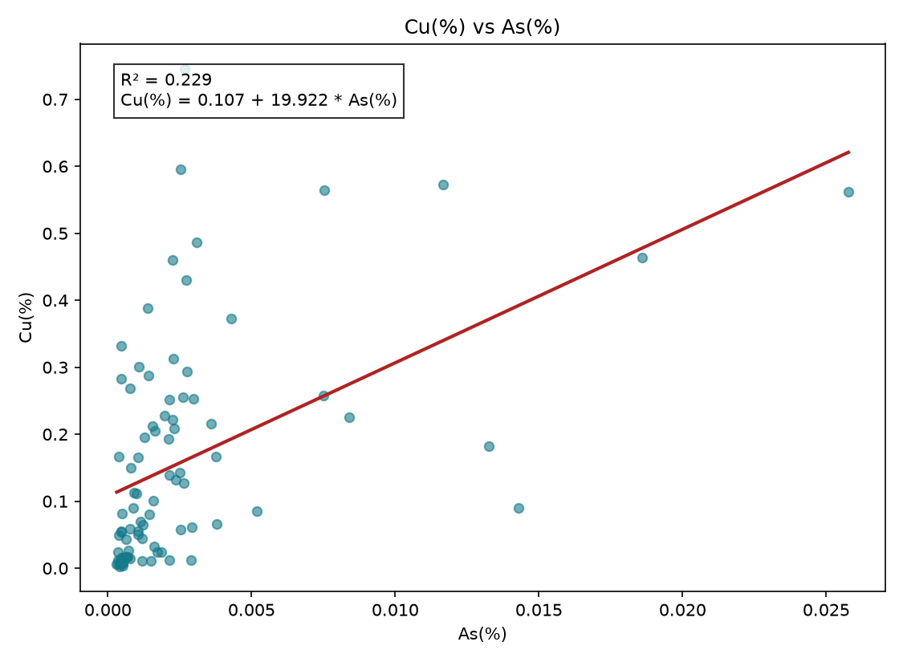
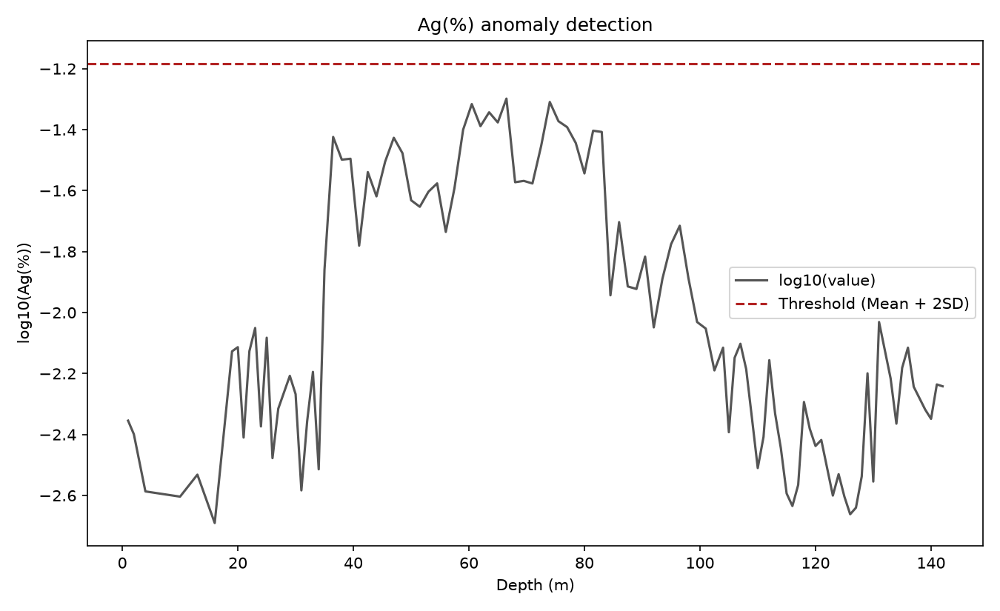
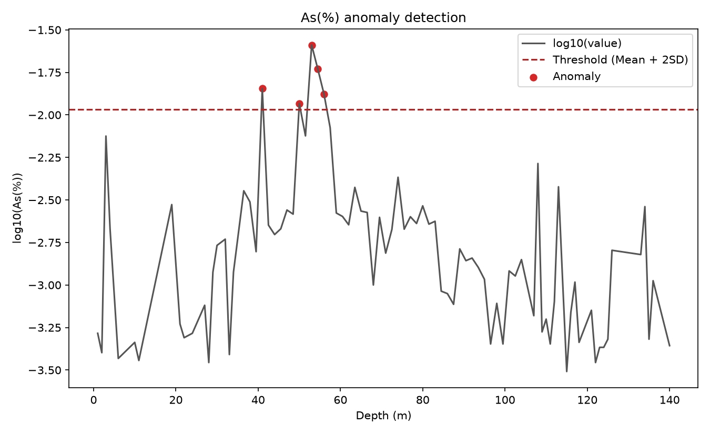
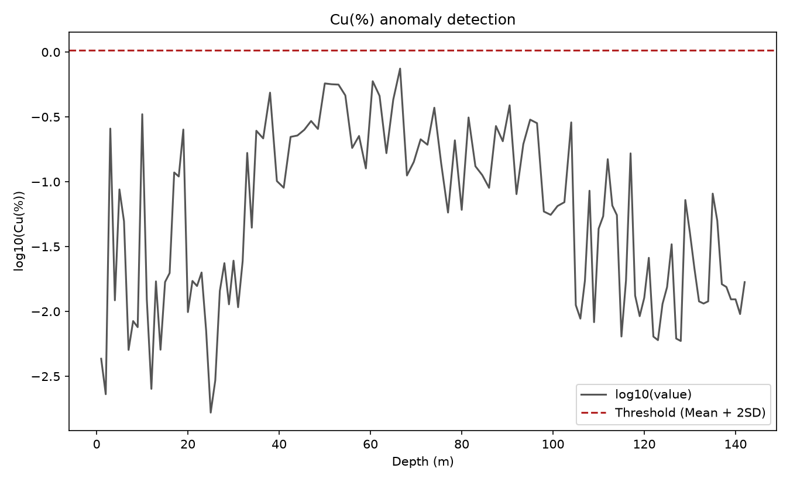

<div dir="rtl">

# ابزار تحلیل داده‌های ژئوشیمیایی

یک ابزار حرفه‌ای مبتنی بر پایتون که برای خودکارسازی تحلیل‌های آماری و بصری داده‌های ژئوشیمیایی طراحی شده است. این پروژه داده‌های غلظت عناصر را پردازش می‌کند تا پروفیل‌های عمقی، توزیع‌های آماری، همبستگی عناصر و ناهنجاری‌های ژئوشیمیایی را استخراج کند.

## 🚀 ویژگی‌ها

- **پردازش داده‌ها**: بارگذاری خودکار فایل‌های CSV و مدیریت مقادیر "کمتر از حد تشخیص" (`<LOD`) از طریق تبدیل آن‌ها به `NaN`.
- **آمار توصیفی**: محاسبه میانگین، انحراف معیار، ضریب تغییرات (CV)، چولگی (Skewness)، کشیدگی (Kurtosis) و چارک‌ها برای عناصر کلیدی.
- **مصورسازی‌های پیشرفته**:
    - **پروفیل‌های عمقی (Depth Profiles)**: ردیابی تغییرات غلظت عناصر نسبت به عمق نمونه‌برداری.
    - **هیستوگرام‌های مقیاس لگاریتمی**: نمایش توزیع فرکانسی عناصر در مقیاس log.
    - **نقشه حرارتی همبستگی (Correlation Heatmap)**: شناسایی روابط و وابستگی‌های متقابل بین عناصر مختلف.
    - **تحلیل رگرسیون**: انجام رگرسیون خطی بین عناصر کلیدی (مانند Cu در مقابل As) به همراه محاسبه ضریب تعیین ($R^2$).
- **شناسایی ناهنجاری‌ها**: شناسایی ناهنجاری‌های ژئوشیمیایی با استفاده از آستانه آماری (میانگین + ۲ انحراف معیار روی داده‌های لگاریتمی).
- **گزارش‌دهی خودکار**: تولید گزارش‌های جامع PDF شامل آمار خلاصه و تمام یافته‌های بصری.

## 📊 مصورسازی‌ها

در ادامه، خروجی‌های کلیدی تولید شده توسط این تحلیل آورده شده است:

### ۱. پروفیل‌های عمقی
نشان‌دهنده تغییرات غلظت عناصر در طول عمق.


### ۲. توزیع عناصر
هیستوگرام‌های فرکانسی عناصر در مقیاس لگاریتمی.


### ۳. ماتریس همبستگی
نقشه حرارتی که روابط بین عناصر مختلف را نشان می‌دهد.


### ۴. تحلیل رگرسیون (Cu vs As)
رابطه خطی بین مس و آرسنیک.


### ۵. شناسایی ناهنجاری
شناسایی بصری ناهنجاری‌های ژئوشیمیایی.





### اجرای تحلیل
فایل داده خود را با نام `geochemical_data.csv` در پوشه اصلی قرار دهید، سپس دستور زیر را اجرا کنید:
```bash
python geochemical_analysis.py
```

## 🧪 تکنولوژی‌های مورد استفاده

- **Python** (زبان اصلی)
- **Pandas** (مدیریت داده‌ها)
- **NumPy** (محاسبات عددی)
- **Matplotlib** (رسم نمودار پایه)
- **Seaborn** (مصورسازی آماری)
- **SciPy** (توابع آماری پیشرفته)

## 👤 نویسنده

**فریبا فخیم علی اکبری**  
*تحلیلگر داده‌های ژئوشیمیایی*

</div>
